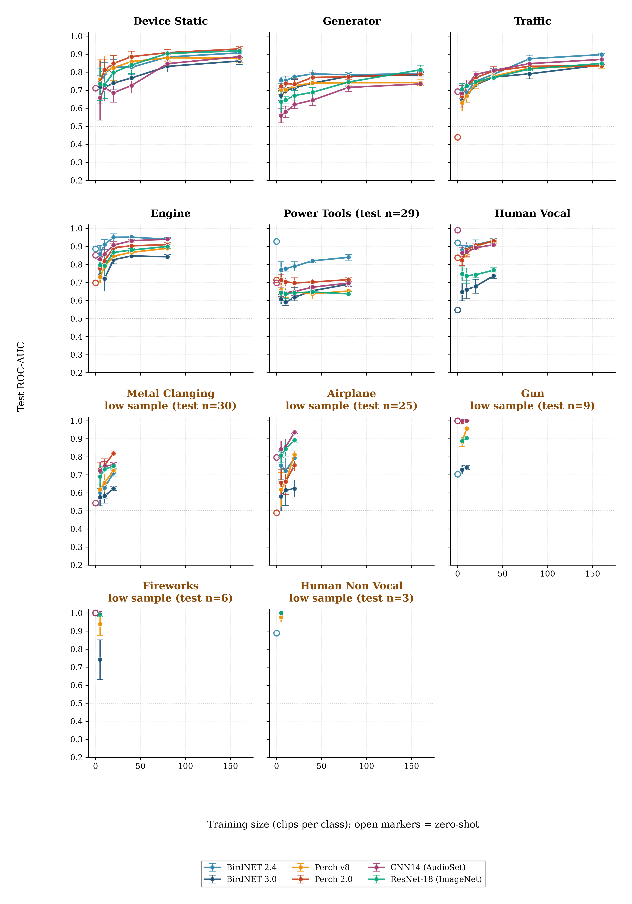
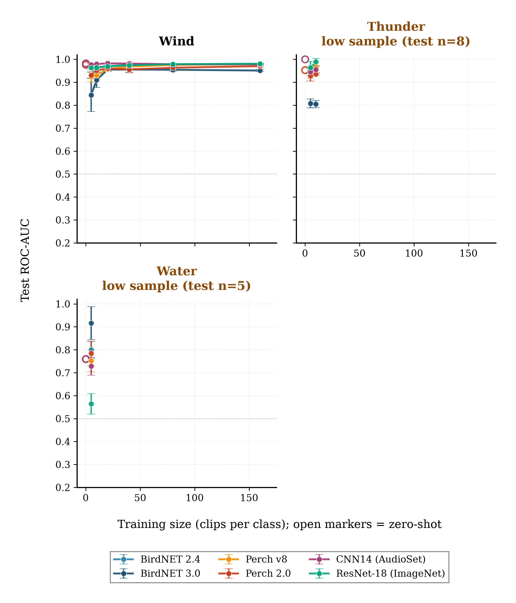
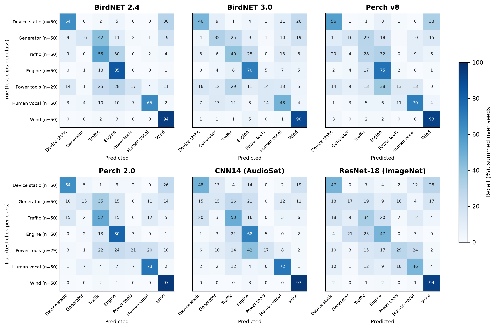

# Artificial and Abiotic Noise Classification with Frozen Audio Embeddings

How many labelled clips does it take to detect artificial noise (engines, traffic, generators, power tools,
device static, …) and abiotic sound (wind, thunder, water) in passive acoustic recordings, using frozen pretrained
audio models? For 14 noise classes and 6 pretrained models, a small classifier head is trained on each model's
embeddings with 5–160 clips per class, giving a saturation curve of test performance against training size, plus
a zero-shot point from each model's own labels.

## Experiment overview

**Training-size experiment** (`main.py`). For each class and model, an MLP head is trained on frozen embeddings with
N clips of the class and N "not this class" clips, for N = 5, 10, 20, 40, 80, 160 (as far as the class's data
allows). Each N is repeated with 10 random training draws; the curves show the mean test ROC-AUC and its 95% CI
across those draws. N = 0 is true zero-shot: the model's own output label for the class, where it has one
(`src/zero_shot_labels.yaml`). Each clip's embedding is computed once per model and cached.

**Headline training size: N = 40.** Across the six well-sampled classes, going from N = 40 to N = 80 adds about
0.01–0.04 test AUC depending on the model (mean +0.026); going from N = 20 to N = 80 adds about 0.05.

**Multiclass experiment** (`experiment/multiclass_fit.py`). One head for "which noise is this?", trained on
exactly the same 40 clips per class as the binary N = 40 draws (10 random draws) and scored on the same test clips.
Currently 7 classes qualify (device static, generator, traffic, engine, power tools, human vocal, wind); classes
with fewer than 40 training clips join automatically once more data is added.

## Classes

The 14 target classes are listed in `src/config.yaml` (`species`, grouped by `class_types`):

- **Artificial noise:** device static, generator, traffic, engine, power tools, human vocal, metal clanging,
  airplane, gun, fireworks, human non-vocal
- **Abiotic:** wind, thunder, water

The other classes in `data/metadata.csv` (frogs, coyote, field cricket, nutria, dog, branches) are used only as
negatives, so the negatives resemble what a noise detector hears in the field.

## Models

| Model | Embedding | Input | Runs on | Zero-shot labels used |
|-------|-----------|-------|---------|-----------------------|
| BirdNET 2.4 (TFLite) | 1024-D (`GLOBAL_AVG_POOL`) | 3 s @ 48 kHz | CPU | Engine, Power tools, Human vocal, Human non-vocal, Gun, Fireworks |
| BirdNET 3.0 (preview3.1) | 1280-D | 3 s @ 32 kHz | GPU if available | Human vocal |
| Perch v8 | 1280-D | 5 s @ 32 kHz (3 s clip centre-padded) | CPU | none (bird labels only) |
| Perch 2.0 | 1536-D | 5 s @ 32 kHz (3 s clip centre-padded) | CPU | FSD50K sound classes (engine, traffic, wind, thunder, water, …) |
| PANNs CNN14 (AudioSet) | 2048-D | 3 s @ 32 kHz | GPU if available | AudioSet classes (static, engine, traffic, clang, …) |
| ResNet-18 (ImageNet) | 512-D | 64-mel spectrogram, 3 s @ 16 kHz | GPU if available | none |

Classifier heads run on the GPU when one is available. TensorFlow/TFLite models always run on the CPU, so the GPU
environment needs CUDA PyTorch only.

## Installation

```bash
pixi install            # laptop / devcontainer (CPU)
pixi install -e gpu     # Linux x86_64 server with an NVIDIA GPU (CUDA 12)
pixi run python scripts/download_models.py   # BirdNET 3.0, Perch 2.0, CNN14 -> models/ (~1.2 GB, once)
```

BirdNET 2.4 and Perch v8 are already in `models/`. ImageNet ResNet weights download automatically on first use.

## Data

Raw clips: Zenodo, DOI [10.5281/zenodo.20534256](https://doi.org/10.5281/zenodo.20534256) (the deposit should be
updated to the layout below).

```
data/
├── metadata.csv             # one row per clip: common_name, source_audio_path, start/end times, filename
└── {class}/*.wav            # 3 s clips, filename as in metadata.csv
```

Only these clips are needed: negatives are drawn in code from the other classes' clips (equal quota per class),
and Perch pads clips to 5 s in code. Check the folder against the metadata (this also prints the table below):

```bash
pixi run python scripts/check_data.py
```

### Test and training split (shared by every experiment)

Clips cut from the same source recording sound alike (same site and background, sometimes overlapping), so the
split is made by **recording**, once, for all classes and experiments: every recording is either a test recording
or a training recording, never both.

- Each class's **test set** is 50 clips from test recordings, and each binary test adds the same number of
  negatives drawn equally from the other classes' test clips. The same test clips are used for every model,
  training size, random draw and experiment (binary, multiclass, zero-shot).
- **Training clips** come only from training recordings. A recording goes to test only if every class in it keeps
  at least 40 training clips.
- **Low-sample classes (\*)** have fewer than 90 clips (50 test + 40 training). They use the same rule with a smaller
  target: about half of their clips (whole recordings) are held out for test and the rest are kept for training.
  Their test sets are small (3–30 clips from 1–13 recordings), so their AUCs are uncertain and should be read as
  provisional. Everything follows from `data/metadata.csv`: when more clips are added, these classes move to the
  full design (50 test clips, larger N) with no code changes.
- About 20% of the negative-only classes' clips are held out as test negatives.

| Class | Type | Recordings / clips | Test recordings / clips | Training recordings / clips | Max N |
|---|---|---|---|---|---|
| Device static | artificial | 168 / 1416 | 9 / 50 | 159 / 1366 | 160 |
| Generator | artificial | 32 / 437 | 10 / 50 | 22 / 384 | 160 |
| Traffic | artificial | 53 / 297 | 13 / 50 | 40 / 242 | 160 |
| Engine | artificial | 115 / 170 | 38 / 50 | 76 / 117 | 80 |
| Power tools | artificial | 11 / 162 | 9 / 29 | 2 / 133 | 80 |
| Human vocal | artificial | 16 / 117 | 14 / 50 | 2 / 64 | 40 |
| Metal clanging * | artificial | 28 / 60 | 13 / 30 | 15 / 30 | 20 |
| Airplane * | artificial | 12 / 52 | 6 / 25 | 6 / 27 | 20 |
| Gun * | artificial | 7 / 19 | 5 / 9 | 2 / 10 | 10 |
| Fireworks * | artificial | 4 / 13 | 2 / 6 | 2 / 7 | 5 |
| Human non vocal * | artificial | 2 / 8 | 1 / 3 | 1 / 5 | 5 |
| Wind | abiotic | 106 / 508 | 11 / 50 | 94 / 453 | 160 |
| Thunder * | abiotic | 5 / 21 | 2 / 8 | 3 / 13 | 10 |
| Water * | abiotic | 3 / 11 | 2 / 5 | 1 / 6 | 5 |

\* low sample: about half of the class's recordings are held out for testing (see README).
163 of 788 recordings are test; the other 625 are training (all classes, including negative-only ones).

Some classes have few training recordings (power tools: 2, human vocal: 2), so their training clips are less
independent than the clip counts suggest.

## Running the training-size experiment

```bash
# 1. Check the zero-shot labels (training clips only; also fills the embedding cache)
pixi run python scripts/zero_shot_label_check.py      # -> results/zero_shot_label_check.md

# 2. Run (resumes per class x model; delete results/runs/{class}_{model}.csv to redo one)
pixi run python main.py

# 3. Saturation figures, one per class type
pixi run python scripts/training_size_plots.py        # -> figs/artificial.png, figs/abiotic.png
```

Outputs: `results/runs/{class}_{model}.csv` (every random draw), `results/results_{class}.csv` (mean, SD and 95% CI
per training size, low-sample flag), `results/predictions/{class}_{model}.csv` (every test clip's score, for
bootstraps or paired model comparisons), `results/embeddings/{model}/` (cache), `figs/results_{class}_plot.png`.





### Running on the cirrus GPU server

```bash
nvidia-smi && uname -m                     # GPU visible, x86_64
git clone https://github.com/avanscoyoc/non-avian-ml.git && cd non-avian-ml
curl -fsSL https://pixi.sh/install.sh | bash && source ~/.bashrc
pixi install -e gpu
pixi run -e gpu python -c "import torch; print(torch.cuda.is_available())"   # True
pixi run -e gpu python scripts/download_models.py
# copy data/ (with metadata.csv) to the server, e.g. zip -r data.zip data on the laptop, then unzip
pixi run -e gpu python scripts/check_data.py
# TensorFlow models use the CPU and PyTorch models the GPU, so run them as two parallel jobs
nohup pixi run -e gpu python main.py --models birdnet perch perch2 > run_cpu.log 2>&1 &
nohup pixi run -e gpu python main.py --models birdnet3 cnn14 resnet > run_gpu.log 2>&1 &
tail -f run_cpu.log run_gpu.log
```

Whichever job finishes last writes the complete `results_*.csv` files. Completed class × model runs are skipped on
restart, and cached embeddings are reused. On a CPU-only machine run a single `main.py`: parallel jobs there just
compete for the same cores. `--species` runs a subset of classes on the same split.

## Running the multiclass experiment

After `main.py` (the figures compare against its binary results at N = 40):

```bash
pixi run python experiment/multiclass_fit.py          # -> results/experiment/
pixi run python experiment/figures.py                 # -> figs/*_noise.{png,pdf}
```

Outputs: `multiclass_noise_{model}.csv` (per random draw and class: test n, one-vs-rest AUC, precision, recall,
F1, macro F1), `cm_noise_{model}.npy` (confusion matrices per draw), `multiclass_results.csv` (means and SDs),
and test-clip embeddings for the t-SNE figure. A class without test clips gets NaN metrics and a hatched
"no test clips" row in the confusion matrices.



Also: `figs/binary_vs_multiclass_auc_noise.png` (binary vs one-vs-rest AUC, same test clips) and
`figs/tsne_embeddings_noise.png` (t-SNE of the test-clip embeddings).

## Deployment classifiers

```bash
pixi run python scripts/train_multiclass_birdnet.py    # or train_multiclass_perch.py
pixi run python scripts/train_binary_anthro_birdnet.py # anthropogenic vs natural; or train_binary_anthro_perch.py
```

Trained classifier bundles (weights, labels, preprocessing, embedding-model info) are saved to
`results/classifiers/`. These scripts still use clip-level train/test splits.

## Citation

```bibtex
@software{non_avian_ml_2025,
  title = {Non-Avian ML Audio Classification Framework},
  author = {Van Scoyoc, Amy},
  year = {2025},
  url = {https://github.com/avanscoyoc/non-avian-ml}
}
```
