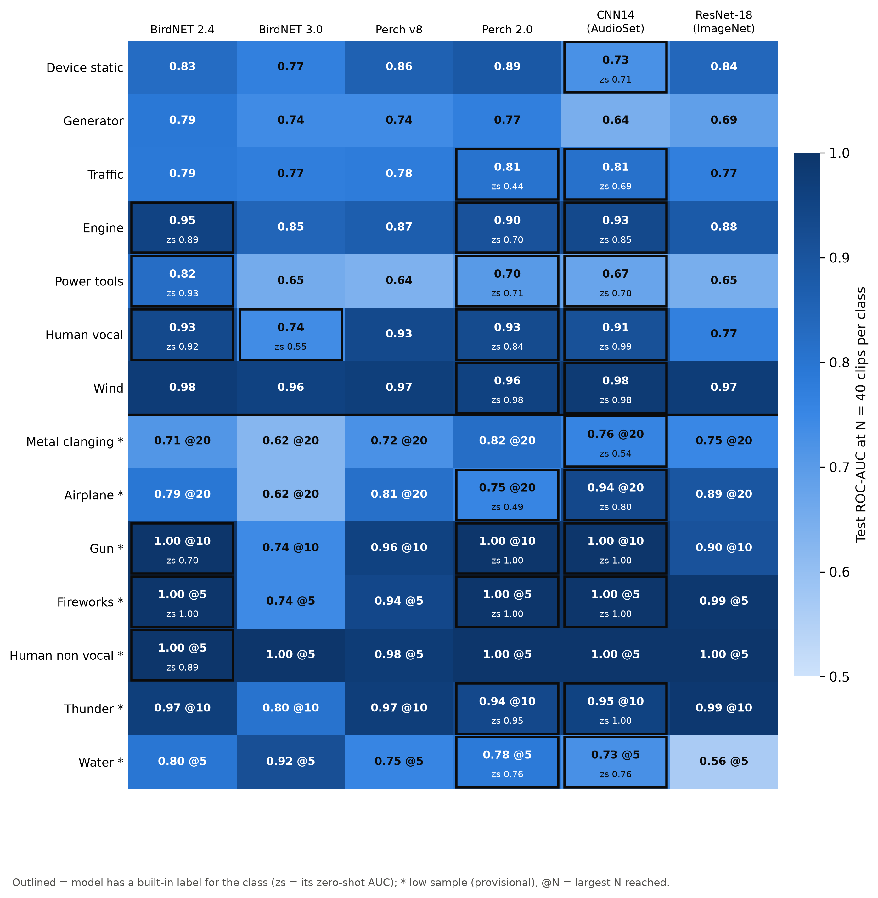

# Transferring pretrained audio models to artificial noise and abiotic sound

How well do frozen pretrained audio models transfer to artificial noise (engines, traffic, generators, power tools,
device static, …) and abiotic sound (wind, thunder, water) in passive acoustic recordings? For 14 noise classes and
6 pretrained models, a small classifier head is trained on each model's embeddings. The findings, figures and
methods are in [docs/brief.md](docs/brief.md) ([PDF](docs/brief.pdf), [slides](docs/slides.pdf)). This README
covers the code and how to reproduce the figures.

## Key findings

1. **About 40 labelled clips per class is enough for most classes.** A small head on frozen embeddings reaches a
   mean test AUC of 0.69–0.97 across the well-sampled classes at N = 40, and most curves are close to their best
   by then.
2. **The sound class matters more than the model.** Wind and engine are easy for every model, and generator and
   power tools are hard for every model. BirdNET 2.4 is best on average, and an ImageNet image model does about as
   well as the general-audio model CNN14.
3. **A trained head usually matches or beats a model's built-in label.** Where a model already has a label for
   the class, the head clearly beats it in 13 of 29 cases, typically by N = 5, and ties near the ceiling in 7.
4. **Errors fall between acoustically similar sounds:** vehicle noise, impulsive sounds, wind and thunder, and
   device static and wind. The same confusions appear in binary detectors, in a multiclass head and in the
   embeddings themselves.
5. **Longer input windows help only generator.** With BirdNET 3.0, 5–10 s windows instead of 3 s improve
   generator and leave the other classes unchanged.



*Test AUC at N = 40 clips per class (Figure 2 of the brief). Outlined cells: the model has a built-in label for
the class, and "zs" is that label's zero-shot AUC. Classes marked \* have few clips (provisional).*

## Quick start

```bash
pixi install          # https://pixi.sh
pixi run figures      # redraw every figure in figs/ from the saved results: no audio or models needed
```

Rerunning the experiments themselves also needs the audio clips and the pretrained models: see
[Installation](#installation) and [Data](#data).

## Repository layout

```
config.yaml     settings shared by every experiment
core/           shared machinery, runs nothing itself: data split and training draws, encoders, embedding
                cache, classifier heads, plotting
experiments/    one module per experiment in the brief; each saves results/<name>/ and draws its figures
scripts/        data and setup utilities
data/           metadata.csv, window manifests and splits/ (tracked); audio clips from Zenodo (not in git)
cache/          model files and embeddings (not in git; rebuilt on demand, safe to delete)
results/        results numbers, used in the brief
figs/           figures calculated from results, used in the brief
docs/           brief.md (+ PDF) and slides
```

## Experiments

| Experiment | In the brief | Run | Figures (`figs/`) |
|---|---|---|---|
| Training size (saturation) and zero-shot | Figures 1, 2, S1 | `pixi run saturation` | `saturation_main`, `saturation_summary`, `saturation_low_sample` |
| Linear probe vs MLP head | Figure S2 | `pixi run linear-probe` | `head_comparison` |
| Binary cross-detection | Figures 3, S3, cutoff note | `pixi run cross-detection` | `cross_detection`, `cross_detection_all_data` |
| One multiclass head | Figures 4–6 | `pixi run multiclass` | `confusion_matrices`, `tsne_embeddings`, `binary_vs_multiclass_auc` |
| Input window length (BirdNET 3.0) | Figure 7, Table S3 | `pixi run window-length` | `window_size` |

Each experiment writes to `results/<experiment>/` (outputs are listed at the top of its module), skips work whose
results are already saved (delete the file it names to redo it) and then draws its figures; `--plot` only redraws,
e.g. `pixi run python -m experiments.multiclass --plot`. The linear probe and multiclass experiments compare
against the saturation results, so run saturation first.

```bash
pixi run experiments    # all five, in order (checks data/splits/ first)
pixi run figures        # redraw every figure from results/
pixi run brief          # build docs/brief.pdf
pixi run slides         # build docs/slides.pdf
```

Shared design (`core/`):

- **One split by source recording**, used by every experiment (`core/data.py`, `core/study.py`). Clips cut from the
  same recording sound alike, so every recording is either a test or a training recording, never both. Each class
  has the same test clips in every experiment, and the same training draw for a given N and seed. The exact
  training and test clips of every experiment are in [`data/splits/`](data/splits/README.md), checked against
  the code before each run (`pixi run check-splits`).
- **Frozen encoders** (`core/encoders.py`). Each clip is embedded once per model and cached (`core/embeddings.py`).
- **Heads** (`core/heads.py`). MLP Linear → 256 → 64 → 2, dropout 0.3, Adam, 20 epochs, batch 32. Each training
  size N is repeated with 10 random training draws; results are means with 95% CIs across draws.
- **Zero-shot (N = 0)**: a model's own output label for the class, where it has one
  (`zero_shot_labels` in `config.yaml`; review with `pixi run zero-shot-labels`, which uses training clips only).

## Classes

The 14 target classes are listed in `config.yaml` (`classes`, grouped by `class_types`):

- **Artificial noise:** device static, generator, traffic, engine, power tools, human vocal, metal clanging,
  airplane, gun, fireworks, human non-vocal
- **Abiotic:** wind, thunder, water

The other classes in `data/metadata.csv` (frogs, coyote, field cricket, nutria, dog, branches) are used only as
negatives, so the negatives resemble what a noise detector hears in the field.

## Models

| Model | Embedding | Input | Runs on | Zero-shot labels used |
|-------|-----------|-------|---------|-----------------------|
| BirdNET 2.4 (TFLite) | 1024-D (`GLOBAL_AVG_POOL`) | 3 s @ 48 kHz | CPU | Engine, Power tools, Human vocal, Human non-vocal, Gun, Fireworks |
| BirdNET 3.0 (preview3.1) | 1280-D | 3 s @ 32 kHz | GPU if available | Human vocal |
| Perch v8 | 1280-D | 5 s @ 32 kHz (3 s clip centre-padded) | CPU | none (bird labels only) |
| Perch 2.0 | 1536-D | 5 s @ 32 kHz (3 s clip centre-padded) | CPU | FSD50K sound classes (engine, traffic, wind, thunder, water, …) |
| PANNs CNN14 (AudioSet) | 2048-D | 3 s @ 32 kHz | GPU if available | AudioSet classes (static, engine, traffic, clang, …) |
| ResNet-18 (ImageNet) | 512-D | 64-mel spectrogram, 3 s @ 16 kHz | GPU if available | none |

Classifier heads run on the GPU when one is available. TensorFlow/TFLite models always run on the CPU, so the GPU
environment needs CUDA PyTorch only.

## Installation

```bash
pixi install                # laptop / devcontainer (CPU)
pixi install -e gpu         # Linux x86_64 server with an NVIDIA GPU (CUDA 12)
pixi run download-models    # optional: all six models -> cache/models/ (~1.5 GB); otherwise each downloads on first use
```

## Data

Raw clips: Zenodo, DOI [10.5281/zenodo.20534256](https://doi.org/10.5281/zenodo.20534256)

```
data/
├── metadata.csv                      # one row per clip: common_name, source_audio_path, start/end times, filename
├── clips/{class}/*.wav               # 3 s clips, filename as in metadata.csv
├── splits/                           # exact train/test clips of every experiment, see data/splits/README.md
└── windows/                          # window-length experiment, see data/windows/README.md
    ├── manifest.csv                  # kept clips: window bounds and source recording
    ├── feasibility_all_clips.csv     # every metadata.csv row and whether it could be cut at 10 s
    └── {3s,5s,10s}/{class}/*.wav     # the same events cut at three lengths (scripts/make_window_clips.py)
```

Only these clips are needed: negatives are drawn in code from the other classes' clips (equal quota per class),
and Perch pads clips to 5 s in code. Check the folder against the metadata (this also prints the table below):

```bash
pixi run check-data
```

### Test and training split (shared by every experiment)

- Each class's **test set** is 50 clips from test recordings, and each binary test adds the same number of
  negatives drawn equally from the other classes' test clips. The same test clips are used for every model,
  training size, random draw and experiment (binary, multiclass, zero-shot).
- **Training clips** come only from training recordings. A recording goes to test only if every class in it keeps
  at least 40 training clips.
- **Low-sample classes (\*)** have fewer than 90 clips (50 test + 40 training). They use the same rule with a smaller
  target: about half of their clips (whole recordings) are held out for test and the rest are kept for training.
  Their test sets are small (3–30 clips from 1–13 recordings), so their AUCs are provisional. Everything follows
  from `data/metadata.csv`: when more clips are added, these classes move to the full design (50 test clips,
  larger N) with no code changes.
- About 20% of the negative-only classes' clips are held out as test negatives.

Of the 788 recordings, 163 are test and 625 are training (all classes, including negative-only ones). The
recordings and clips per class are in Table 1 of the brief, and `pixi run check-data` prints the same table from
`data/metadata.csv`. [`data/splits/partition.csv`](data/splits/README.md) lists every clip with its recording and
split. Some classes have few training recordings (power tools: 2, human vocal: 2), so their training clips are
less independent than the clip counts suggest.

## Running on a GPU server

```bash
nvidia-smi && uname -m                     # GPU visible, x86_64
git clone https://github.com/avanscoyoc/non-avian-ml.git && cd non-avian-ml
curl -fsSL https://pixi.sh/install.sh | bash && source ~/.bashrc
pixi install -e gpu
pixi run -e gpu python -c "import torch; print(torch.cuda.is_available())"   # True
pixi run -e gpu download-models
# copy the audio to the server (data/clips/, data/windows/{3s,5s,10s}/), e.g. zip on the laptop, then unzip
pixi run -e gpu check-data
pixi run -e gpu check-splits               # the direct python runs below skip this check
# TensorFlow models use the CPU and PyTorch models the GPU, so run the saturation experiment as two parallel jobs
nohup pixi run -e gpu python -m experiments.saturation --models birdnet perch perch2 > run_cpu.log 2>&1 &
nohup pixi run -e gpu python -m experiments.saturation --models birdnet3 cnn14 resnet > run_gpu.log 2>&1 &
tail -f run_cpu.log run_gpu.log
pixi run -e gpu experiments                # the rest (completed saturation runs are skipped)
```

Whichever saturation job finishes last writes the complete `results/saturation/auc_by_n.csv`. Completed
class × model runs are skipped on restart, and cached embeddings are reused. On a CPU-only machine, run a single
job. `--classes` runs a subset of classes on the same split.

## Citation

Please cite the code, splits and results with [`CITATION.cff`](CITATION.cff) (GitHub's "Cite this repository"),
and the audio clips with their Zenodo DOI, [10.5281/zenodo.20534256](https://doi.org/10.5281/zenodo.20534256).

```bibtex
@software{vanscoyoc_noise_transfer_2026,
  title  = {Transferring pretrained audio models to artificial noise and abiotic sound},
  author = {Van Scoyoc, Amy},
  year   = {2026},
  url    = {https://github.com/avanscoyoc/non-avian-ml}
}
```

## License

The code is BSD 3-Clause licensed ([LICENSE.md](LICENSE.md)). `core/cnn14.py` adapts the PANNs CNN14
architecture (MIT license), and `docs/lapreprint-custom/` is based on the LaPreprint template (MIT). The audio clips
are covered by the terms of their Zenodo record. The pretrained models are downloaded from their original sources
and are covered by their own licenses.

## Acknowledgements

Developed at the Eric and Wendy Schmidt Center for Data Science and the Environment at UC Berkeley.
Audio recordings were gathered by Amy Van Scoyoc and the California Department of Fish and Wildlife. 
Thanks to the many students and colleagues who reviewed and verified audio for this project.
