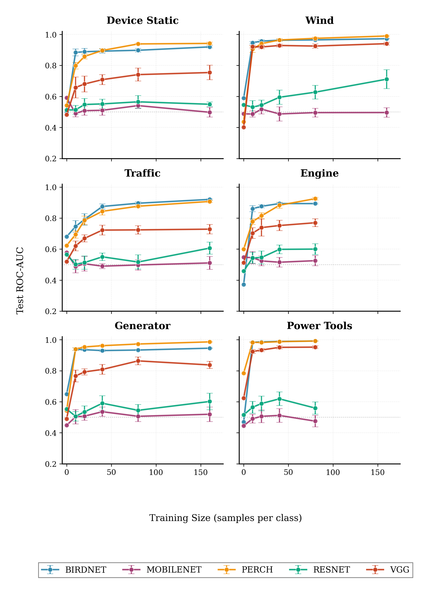
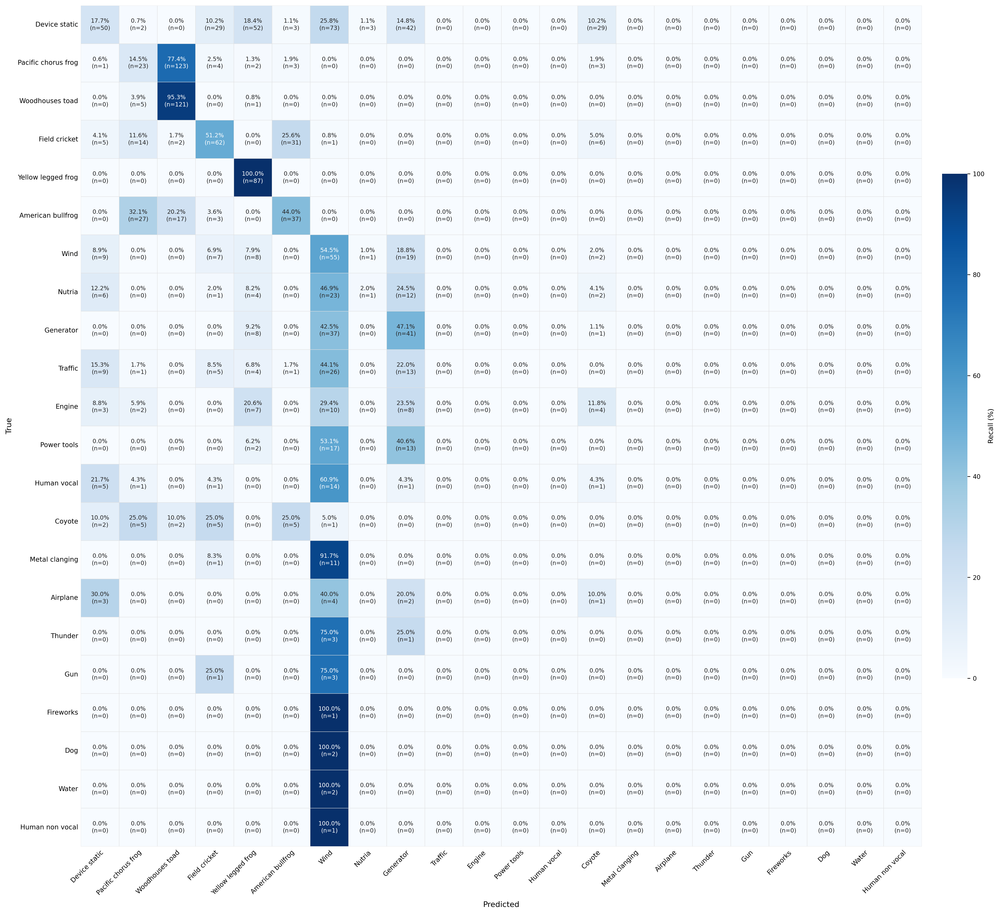

# Non-Avian ML Audio Classification

Evaluates frozen pretrained audio embeddings for classifying non-avian wildlife and environmental sounds. A lightweight MLP head is trained on each model's embeddings across training sizes (10–160 clips per class) to produce saturation curves; the same embeddings also power production multiclass and binary classifiers.

## Experiment overview

**Training-size experiment** (`main.py`). For each class and model: train an MLP head on frozen embeddings with N positive and N negative clips (negatives drawn equally from the other classes), for N = 10–160 per class. Each N is repeated with 10 random training draws (seeds); the curves show the mean test AUC and its 95% CI across those draws. Each clip's embedding is computed once per model and cached, and all draws for a training size are trained together. The N = 0 point is true zero-shot: the model's own label for the class, where it has one.

**Multiclass experiment** (`experiment/multiclass_fit.py`). One head per group (4 anuran classes; 6 non-biotic classes), trained on the same 80 clips per class as the binary N = 80 draws and scored on the same test clips.

**Multiclass and binary classifiers** (`scripts/train_multiclass_*.py`, `scripts/train_binary_anthro_*.py`). Single MLPs trained on BirdNET or Perch embeddings for deployment.

## Models

| Model | Embedding | Input | Runs on | Zero-shot labels |
|-------|-----------|-------|---------|------------------|
| BirdNET 2.4 (TFLite) | 1024-D (`GLOBAL_AVG_POOL`) | 3 s @ 48 kHz | CPU | 6,522 (birds, some frogs/insects/mammals, engine, power tools, human) |
| BirdNET 3.0 (preview3.1) | 1280-D | 3 s @ 32 kHz | GPU if available | 11,560 (birds and non-birds) |
| Perch v8 | 1280-D | 5 s @ 32 kHz (3 s clip centre-padded) | CPU | birds only (not used) |
| Perch 2.0 | 1536-D | 5 s @ 32 kHz (3 s clip centre-padded) | CPU | 14,795 (iNaturalist + FSD50K sounds) |
| PANNs CNN14 (AudioSet) | 2048-D | 3 s @ 32 kHz | GPU if available | 527 AudioSet classes |
| ResNet-18 (ImageNet) | 512-D | 64-mel spectrogram, 3 s @ 16 kHz | GPU if available | none |

All classifier heads run on the GPU when one is available. TensorFlow/TFLite models always run on the CPU, so the GPU environment needs CUDA PyTorch only.

## Installation

```bash
pixi install            # laptop / devcontainer (CPU)
pixi install -e gpu     # Linux x86_64 server with an NVIDIA GPU (CUDA 12)
pixi run python scripts/download_models.py   # BirdNET 3.0, Perch 2.0, CNN14 -> models/ (~1.2 GB, once)
```

BirdNET 2.4 and Perch v8 are already in `models/`. ImageNet ResNet weights download automatically on first use.

## Data

Raw clips: Zenodo, DOI [10.5281/zenodo.20534256](https://doi.org/10.5281/zenodo.20534256) (the deposit should be updated to the layout below).

Only the positive clips are needed. Negatives for each class are drawn in code from the other classes' clips (equal quota per donor class), and Perch pads clips to 5 s in code.

```
data/
├── metadata.csv             # one row per clip: common_name, source_audio_path, start/end times, filename
└── {class}/*.wav            # 3 s clips, filename as in metadata.csv
```

Check the folder against the metadata (every clip present, nothing extra); this also prints the table below:

```bash
pixi run python scripts/check_data.py
```

### Test and training split (shared by every experiment)

Clips cut from the same source recording sound alike (same site and background, sometimes overlapping), so the
split is made by **recording**, once, for all classes and experiments: every recording is either a test recording
or a training recording, never both.

- Each class's **test set** is 50 clips from test recordings (power tools: 30, the most its small recordings
  allow). Binary tests add 50 negatives drawn equally from the other classes' test clips. The same test clips are
  used for every model, training size, seed and experiment (binary, multiclass, zero-shot).
- **Training clips** come only from training recordings. A recording goes to test only if every class in it keeps
  enough training clips (80 for the multiclass classes, 40 otherwise), which sets the largest training size.
- The other 9 classes in `metadata.csv` (airplane, dog, gun, …) are only used as negatives; about 20% of their
  clips are held out as test negatives.

| Class | Recordings / clips | Test recordings / clips | Training recordings / clips | Max N |
|---|---|---|---|---|
| Device static | 168 / 1416 | 11 / 50 | 157 / 1350 | 160 |
| Pacific chorus frog | 41 / 795 | 11 / 50 | 30 / 736 | 160 |
| Woodhouses toad | 24 / 638 | 9 / 50 | 15 / 587 | 160 |
| Field cricket | 103 / 605 | 12 / 50 | 90 / 545 | 160 |
| Yellow legged frog | 44 / 436 | 4 / 50 | 40 / 380 | 160 |
| American bullfrog | 13 / 421 | 8 / 50 | 5 / 359 | 160 |
| Wind | 106 / 508 | 12 / 50 | 94 / 455 | 160 |
| Nutria | 95 / 245 | 23 / 50 | 72 / 194 | 160 |
| Generator | 32 / 437 | 9 / 50 | 23 / 383 | 160 |
| Traffic | 53 / 297 | 13 / 50 | 40 / 242 | 160 |
| Engine | 115 / 170 | 33 / 50 | 80 / 115 | 80 |
| Power tools | 11 / 162 | 10 / 30 | 1 / 132 | 80 |
| Human vocal | 16 / 117 | 13 / 50 | 3 / 65 | 40 |
| Coyote | 25 / 101 | 16 / 50 | 9 / 50 | 40 |

153 of 788 recordings are test; the other 635 are training.

Some classes have few training recordings (power tools: 1, human vocal: 3, bullfrog: 5), so their training clips
are less independent than the clip counts suggest.

## Running the training-size experiment

```bash
# 1. Review the zero-shot label mapping (uses training clips only; fills the embedding cache)
pixi run python scripts/zero_shot_label_check.py      # -> results/zero_shot_label_check.md
#    edit src/zero_shot_labels.yaml if needed

# 2. Run (resumes per class x model; delete results/runs/{class}_{model}.csv to redo one)
pixi run python main.py

# 3. Saturation figures for the manuscript groups
pixi run python scripts/training_size_plots.py        # -> figs/broadband.png, pulsed.png, variable.png
```

Outputs: `results/runs/{class}_{model}.csv` (every seed), `results/results_{class}.csv` (mean, SD, 95% CI per training size), `results/embeddings/{model}/` (cache), `figs/results_{class}_plot.png`.



### Running on the cirrus GPU server

```bash
nvidia-smi && uname -m                     # GPU visible, x86_64
git clone https://github.com/avanscoyoc/non-avian-ml.git && cd non-avian-ml
curl -fsSL https://pixi.sh/install.sh | bash && source ~/.bashrc
pixi install -e gpu
pixi run -e gpu python -c "import torch; print(torch.cuda.is_available())"   # True
pixi run -e gpu python scripts/download_models.py
# copy data/ (with metadata.csv) to the server, e.g. zip -r data.zip data on the laptop, then unzip
pixi run -e gpu python scripts/check_data.py
# TensorFlow models use the CPU and PyTorch models the GPU, so run them as two parallel jobs
nohup pixi run -e gpu python main.py --models birdnet perch perch2 > run_cpu.log 2>&1 &
nohup pixi run -e gpu python main.py --models birdnet3 cnn14 resnet > run_gpu.log 2>&1 &
tail -f run_cpu.log run_gpu.log
```

Whichever job finishes last writes the complete `results_*.csv` files. Completed class × model runs are skipped on restart, and cached embeddings are reused. On a CPU-only machine run a single `main.py`: parallel jobs there just compete for the same cores.

## Multiclass and binary classifiers

```bash
pixi run python scripts/train_multiclass_birdnet.py    # or train_multiclass_perch.py
pixi run python scripts/train_binary_anthro_birdnet.py # or train_binary_anthro_perch.py
```



Trained classifier bundles (weights, labels, preprocessing, embedding-model info) are saved to `results/classifiers/`. Note these scripts still use clip-level train/test splits.

## Citation

```bibtex
@software{non_avian_ml_2025,
  title = {Non-Avian ML Audio Classification Framework},
  author = {Van Scoyoc, Amy},
  year = {2025},
  url = {https://github.com/avanscoyoc/non-avian-ml}
}
```
